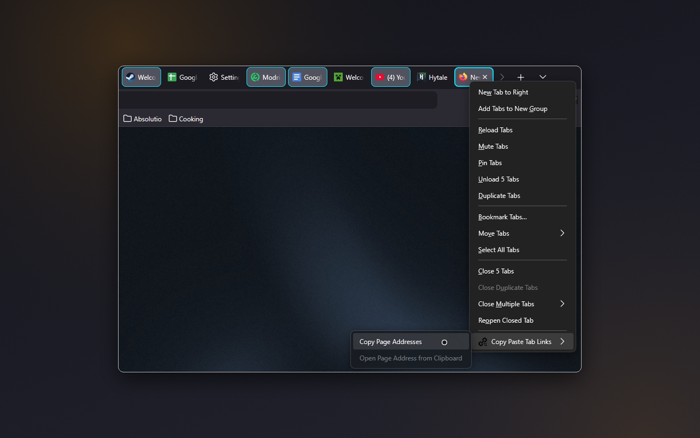
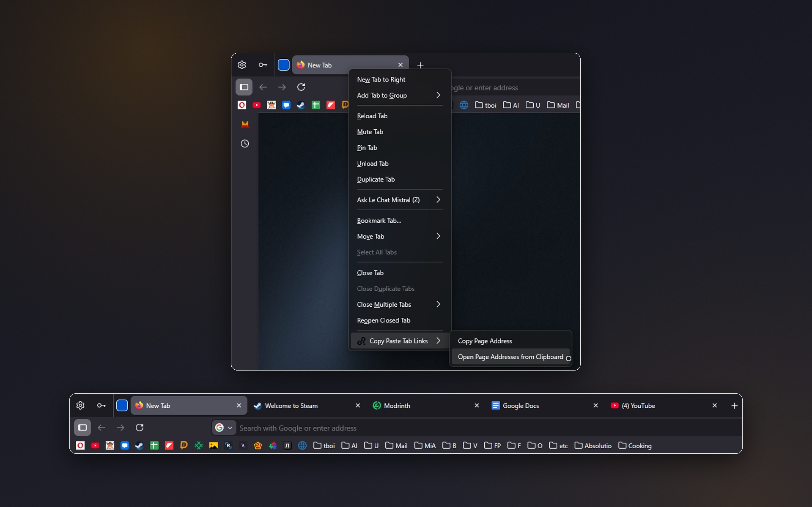

# Copy Paste Tab Links

A lightweight Firefox extension for working with many tabs: copy the URLs of several selected tabs at once, and open lists of links straight from your clipboard.

**[Install from addons.mozilla.org](https://addons.mozilla.org/firefox/addon/copy-paste-tab-links/)**

## Screenshots

| | |
|:---:|:---:|
|  Select several tabs, right-click any of them and choose Copy Page Addresses – all URLs go to the clipboard. |  Right-click a tab and choose Open Page Addresses from Clipboard – every copied link opens in its own tab. |

## Features
- **Copy selected tabs** – select tabs with **Ctrl** or **Shift + click**, right-click any of them and choose **Copy Page Addresses**. URLs are copied one per line, as plain URLs, **Markdown** `[Title](Url)` or **HTML** links.
- **Open links from the clipboard** – right-click a tab and choose **Open Page Addresses from Clipboard**. The extension finds valid URLs in the clipboard text and opens each in its own tab, in the current or a new window.
- **Options** – choose the copy format, the paste behavior, and whether the "Paste & Open" item is shown.

## Technical details
- Manifest V3, event-based: no background memory when idle
- **No data collection**, tracking, or analytics

## Localization
Translated into **19 languages**: English, Spanish, German, French, Russian, Belarusian, Chinese (Simplified and Traditional), Japanese, Portuguese, Italian, Korean, Polish, Dutch, Turkish, Ukrainian, Indonesian, Arabic, and Vietnamese.

## Support
[Telegram](https://t.me/kustric) · [Ko-fi](https://ko-fi.com/kustrica) · [Patreon](https://www.patreon.com/kustrica) · [Boosty](https://boosty.to/kustrica)
